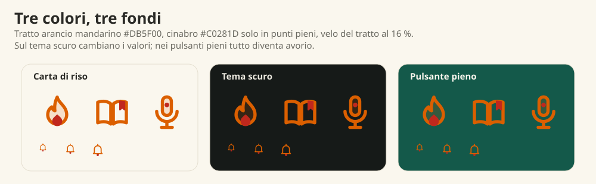

# Il disegno delle icone di màndarínō

Perché le icone sono fatte così, da dove vengono, come ci siamo arrivati e perché ci siamo fermati. Le figure si rifanno con
`node tools/icone-storia.mjs`. La specifica tecnica (licenza, regole, come usarle) è in [ICONE.md](ICONE.md).

## In breve

Un segno **sobrio, caldo, nobile e vivo**, che mette insieme due scuole che sembrano lontane e in realtà hanno la stessa ossessione:
**togliere**. Dalla calligrafia cinese prendiamo la *tensione del tratto* e il *vuoto che respira* (留白, liúbái). Dal design italiano
del dopoguerra (Munari, Castiglioni, Vignelli: li citiamo come ispirazione, non li copiamo) prendiamo la *sottrazione* e la
*costruzione su griglia*. Il risultato non vuole essere «cinese da ristorante» né «italiano da cartolina»: vuole essere un linguaggio
nostro, leggibile a 16 pixel e bello a 160.

## Perché non le emoji

Un'emoji la disegna chi produce il telefono (Apple, Google, Microsoft, Samsung): ognuno a modo suo, piena, ombreggiata, con il
contorno scuro e la lucina. Dentro un'app di studio fa un effetto cartoon che non è il nostro tono, e cambia da un telefono all'altro.
Volevamo icone **nostre**, uguali ovunque, coerenti con la carta di riso, il verde dei pulsanti e l'arancio del mandarino, e che
chiunque possa riusare con la licenza CC BY 4.0.

## Il punto di partenza: i caratteri

Abbiamo guardato come si costruisce un carattere, non come appare. Quattro esempi (gli schizzi dei tratti sono nostri e semplificati):

- **火 (huǒ, fuoco).** Quattro tratti, due scintille che si staccano. Ne nasce l'idea che la fiamma non sia una goccia chiusa e che la fiammella
  interna sia un punto a parte.
- **心 (xīn, cuore).** Un gancio (钩) che frena e riparte, con tre punti. Ne nasce la curva asimmetrica del cuore, e il suo essere un punto
  pieno, come un sigillo.
- **门 (mén, porta).** L'asta e il tratto con il gancio, e lo spazio tra battente e stipite. Ne nasce il lucchetto con l'arco sospeso.
- **日 (rì, giorno).** Una finestra divisa in due. Ne nasce l'intestazione del calendario e il suo punto, che segna «oggi».

Dalla calligrafia prendiamo tre principi, e li abbiamo tradotti in regole di disegno:

1. **Tensione del tratto** (笔势, bǐshì): gli angoli non sono raggi circolari da interfaccia tecnologica ma curve che frenano e ripartono,
   come un cambio di direzione del pennello (折 zhé, 钩 gōu). Gli angoli sono smussati ma decisi; le uscite hanno un piccolo slancio.
2. **Pieno e vuoto** (留白, liúbái): gli oggetti non si saldano. Il libro non ha la costola, la lente si apre dove nasce il manico, il battaglio
   della campana è sospeso. Lo spazio bianco fa parte del segno quanto il tratto.
3. **Il quadrato** (方块, fāngkuài): ogni carattere vive in un quadrato ideale; ogni icona nasce nel suo, diviso in nove.

## L'impronta italiana: sottrarre

Il design italiano che ammiriamo è fatto di sottrazione: si toglie finché non si può togliere altro. Lo abbiamo fatto con una campana,
partendo da tutto quello che c'è in un'icona «ricca» (ombra, luce, bordo, battaglio, onde del suono):

«Complicare è facile, semplificare è difficile» (Bruno Munari). Nel quarto passaggio il battaglio si stacca dal corpo: è il momento in cui
il design italiano e il bianco della carta cinese dicono la stessa cosa.

## L'evoluzione: sei passaggi

Non ci siamo arrivati al primo colpo. Tre icone (fiamma, libro, campana) in sei versioni:

| Passaggio | Che cosa abbiamo visto | Perché non basta |
|---|---|---|
| **Emoji tipica** | Piena, ombreggiata, contorno scuro | È il linguaggio di tutti i telefoni: cartoon, e non è nostra |
| **A · Carta di riso** | Inchiostro con un velo di pennello e un accento cinabro | Poetica, ma a 16 px i doppi tratti sottili si indeboliscono e il nero spegne |
| **B · Giada** | Corpi velati di verde, tratto solido, bella silhouette | Il verde freddo si confonde con i pulsanti verdi e non ha il calore del marchio |
| **C · Sigillo** | Glifo inciso su un timbro arancio mandarino | Il colore è perfetto, ma la piastrella ripetuta nei menu pesa: sembra la home di un telefono |
| **D · Sintesi** | Glifo libero (da B) nel calore di C | Il velo arancio su tutto «colora a forza» (le pagine del libro, la fotocamera); il cinabro troppo vicino all'arancio sembra una sbavatura |
| **D2 · Finale** | Velo solo sui corpi pieni, cinabro solo in punti, aria tra i tratti | Il set |

## Le regole del segno

| Regola | Valore | Perché |
|---|---|---|
| Griglia | 24 × 24, margine 2 px | Una sola misura per tutte; leggibile a 16, 20 e 24 px |
| Tratto | 1,8 px, estremità e giunzioni arrotondate | Abbastanza deciso a 16 px, abbastanza leggero a 48 |
| Colore del tratto | arancio mandarino `#DB5F00` | Il colore del marchio; 3,5 : 1 sulla carta di riso |
| Velo | lo stesso arancio al 16 %, **solo** su corpi pieni (fiamma, altoparlante, microfono, note, play, fulmine, stella) | Dà profondità e luce; non colora la carta (pagine, lenti, fotocamera restano vuote) |
| Accento | cinabro `#C0281D`, **solo come punto pieno** (centro del bersaglio, fiammella, punti del fumetto, cuore, segnalibro, battaglio) | Uno stacco netto dall'arancio, che non sembra una sbavatura a 16 px |
| Aria | gli oggetti non si saldano | Il vuoto (留白) fa parte del segno |
| Un solo punto di colore | al massimo uno o due punti pieni per icona | La sobrietà italiana: non decorare |
| Colori nel file | solo tre variabili: `--im` (tratto), `--iv` (velo), `--ia` (accento) | Tema scuro, pulsanti pieni e `currentColor` cambiano solo queste |

La costruzione, sopra la griglia a nove quadri:

I colori su tre fondi: la carta di riso, il tema scuro (`#FF9A3D` e `#E5483C`) e il pulsante pieno, dove tutto diventa avorio:

## Dove ci siamo fermati

Dopo D2 abbiamo provato un passo in più: tratti più spessi, sfumature, filetti, luci. L'icona sembra più «ricca», e a 16 e 20 px è peggiore: il
contorno spesso chiude gli spazi (sparisce il vuoto), le sfumature impastano, il filetto rosso sembra una sbavatura.

Ci fermiamo quando valgono cinque criteri insieme: (1) leggibile a 16 px; (2) un solo punto di colore pieno; (3) gli spazi bianchi restano
aperti; (4) la stessa massa visiva per tutte le icone; (5) nessun dettaglio che non sopravviva alla riduzione. Un'icona che ne
rispetta quattro su cinque non è finita: si toglie ancora.

Per gli adesivi e i formati grandi (non per l'interfaccia) si può dare un lieve ingrossamento alle uscite del tratto, per rendere più evidente
lo slancio del pennello: lì c'è spazio per farlo senza perdere leggibilità.

## Chi le ha disegnate

Le ha disegnate Claudio Longhitano con l'aiuto di Claude (Anthropic), un assistente di intelligenza artificiale, con lo stesso metodo del resto
del progetto: io decido che cosa serve e come deve sentirsi, l'assistente propone, disegna e corregge, e insieme si controlla ogni passaggio
contro le regole qui sopra. La licenza è CC BY 4.0 ([ICONE.md](ICONE.md)). Il nome màndarínō e il logo del mandarino con gli accenti tonali non
fanno parte di questa licenza: vedi [MARCHIO.md](../MARCHIO.md).

## 中文简介

màndarínō 的图标不是表情符号。它们取自汉字的结构而不是外形：**留白**（笔画之间留出空气，不焊死）、**笔势**（转折像毛笔那样“刹住再出发”）、
**方块**（每个图标都在九宫格里）。再加上意大利设计的“减法”：能去掉的都去掉，只留一个朱红的实心焦点。橙色线条 `#DB5F00`，朱红点 `#C0281D`，
只用三个颜色变量，深色主题和按钮里的象牙白都靠它们切换。授权为 CC BY 4.0；名称和标志另见 [MARCHIO.md](../MARCHIO.md)。
